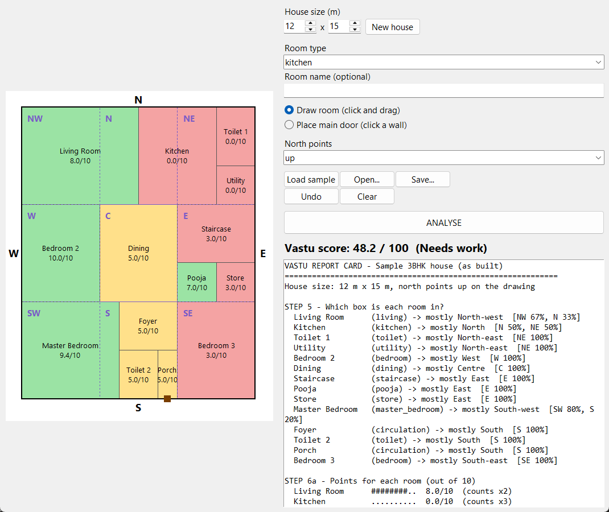
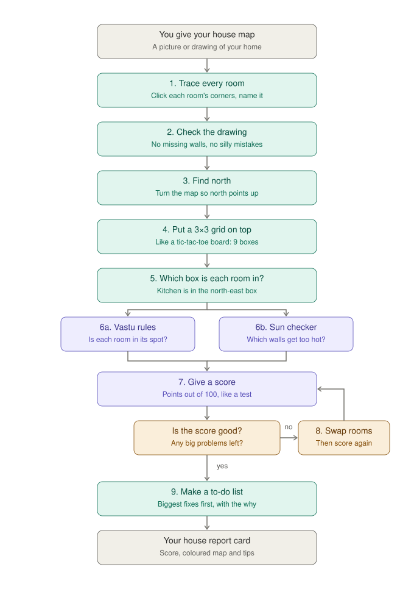

# Vastu Checker for House Maps

[](https://github.com/madhukarverma/vastu-floorplan-analyzer/actions/workflows/ci.yml)


[](LICENSE)

A simple Python project. **Draw your house, click Analyse, and get a Vastu score out of 100**,
with easy-to-follow suggestions to improve it.

- Pure Python, with **no extra libraries** (the window uses Tkinter, which ships with Python).
- **No AI or machine learning.** Every answer comes from clear rules you can read in
  [`rules.py`](src/vastu_analyzer/rules.py).
- Each suggestion explains **why**: the Vastu reason and the science reason.

<p align="center">
  
</p>

## Run it in 1 minute

```bash
git clone https://github.com/madhukarverma/vastu-floorplan-analyzer.git
cd vastu-floorplan-analyzer
pip install -e .
vastu app
```

In the window:

1. Click **Load sample**, or pick a room type and **click-and-drag** to draw each room.
2. Choose **Place main door** and click on an outside wall.
3. Set which way **north** points on your drawing.
4. Click **ANALYSE**. Rooms turn **green** (good), **yellow** (okay) or **red** (bad), and the
   report card appears on the right.

Prefer the terminal? Run:

```bash
vastu analyze examples/sample_house.json
```

## How it works, in simple terms

<p align="center">
  
</p>

Think of your house as a toy box where every toy has a favourite spot. The program checks
whether each room is in its favourite spot, gives the house a score, and tells you how to
tidy up.

| Step | What happens | Code file |
|---|---|---|
| 1. Trace every room | Each room is a rectangle: where it starts (x, y) and its size (w, h) | [`house.py`](src/vastu_analyzer/house.py) |
| 2. Check the drawing | Rooms must be inside the house and must not overlap | [`house.py`](src/vastu_analyzer/house.py) |
| 3. Find north | If north is not "up", the compass labels are turned round | [`compass.py`](src/vastu_analyzer/compass.py) |
| 4. Put a 3×3 grid on top | Like tic-tac-toe: NW, N, NE / W, Centre, E / SW, S, SE | [`compass.py`](src/vastu_analyzer/compass.py) |
| 5. Which box is each room in? | Measure how much of each room falls in each box | [`compass.py`](src/vastu_analyzer/compass.py) |
| 6a. Vastu rules | Each room type has best / good / okay / bad boxes (10 / 7 / 5 / 0 points) | [`rules.py`](src/vastu_analyzer/rules.py) |
| 6b. Sun check | West walls get hottest (about 65 °C in a Delhi summer), so suggest shade | [`sun.py`](src/vastu_analyzer/sun.py) |
| 7. Give a score | Weighted average of all points → a mark out of 100 | [`scoring.py`](src/vastu_analyzer/scoring.py) |
| 8. Swap rooms | Try swapping room uses; keep the swaps that raise the score | [`suggestions.py`](src/vastu_analyzer/suggestions.py) |
| 9. To-do list | Biggest problems first, each with the Vastu reason and the science reason | [`suggestions.py`](src/vastu_analyzer/suggestions.py) |

### The two formulas

**Room points (0–10).** A room can sit across several boxes, so we take a weighted average:

```
points = sum of (share of the room in a box × points for that box)
e.g. kitchen half in SE (10) and half in S (5):  0.5×10 + 0.5×5 = 7.5
```

**House score (0–100).** Important rooms (kitchen, master bedroom, pooja, toilet, main door)
count 3×, others 1–2×:

```
score = 100 × sum(importance × points) / sum(importance × 10)
```

### Example result

| House | Score | Main problems found |
|---|---|---|
| [`sample_house.json`](examples/sample_house.json) (typical builder plan) | **48.2 / 100** (Needs work) | Kitchen in the north / north-east, toilet in the north-east, door in the south |
| …after the 3 suggested swaps | **67.2 / 100** (Good) | Kitchen ↔ Bedroom 3, Toilet 1 ↔ Pooja, Living ↔ Kitchen |
| [`good_house.json`](examples/good_house.json) (well planned) | **91.4 / 100** (Excellent) | Only small sun-shade tips |

Full reports are in [`examples/output/`](examples/output).

## Project files

```
src/vastu_analyzer/
  house.py        STEP 1-2  rooms, door, load/save, check the drawing
  compass.py      STEP 3-5  north, 3x3 grid, which box each room is in
  rules.py        STEP 6a   the Vastu rule book (easy to edit)
  sun.py          STEP 6b   hot-wall check
  scoring.py      STEP 7    points and the score out of 100
  suggestions.py  STEP 8-9  swap game and to-do list
  report.py                 the printed report card
  app.py                    the window app (Tkinter)
  cli.py                    `vastu app` and `vastu analyze`
tests/test_vastu.py         12 small tests, one per step
examples/                   two sample houses + their reports
docs/                       approaches, procedure, input format, presentation guide, paper
```

## More documents

- [Why this approach?](docs/approaches.md): 8 ways to solve the problem, ranked.
- [Step-by-step procedure](docs/procedure.md)
- [House file format](docs/input-format.md)
- [Presentation guide](docs/presentation-guide.md): slides, live demo script, likely questions.
- [Research paper (PDF)](docs/paper/Vastu_Geometric_Physical_Framework.pdf): the full theory,
  including the physics behind the sun check. The paper describes the detailed research model
  (tag [`v1.0.0`](https://github.com/madhukarverma/vastu-floorplan-analyzer/tree/v1.0.0));
  this code is the simplified classroom version of the same idea, so its scores differ.

## For developers

```bash
pip install -e ".[dev]"
pytest            # run the tests
ruff check .      # style check
mypy              # type check
```

## Simplifications (on purpose)

- The house and its rooms are rectangles, and north is one of up / right / down / left.
- One main door. The sun check uses fixed numbers for New Delhi.
- Vastu books differ on some rules; ours are a common consensus and live in one editable file.

## Disclaimer

Vastu Shastra is a traditional system. This tool checks a house against a simple, editable set
of Vastu rules and adds common-sense comfort tips. Talk to an architect before changing a real
building.

## License

[MIT](LICENSE)
