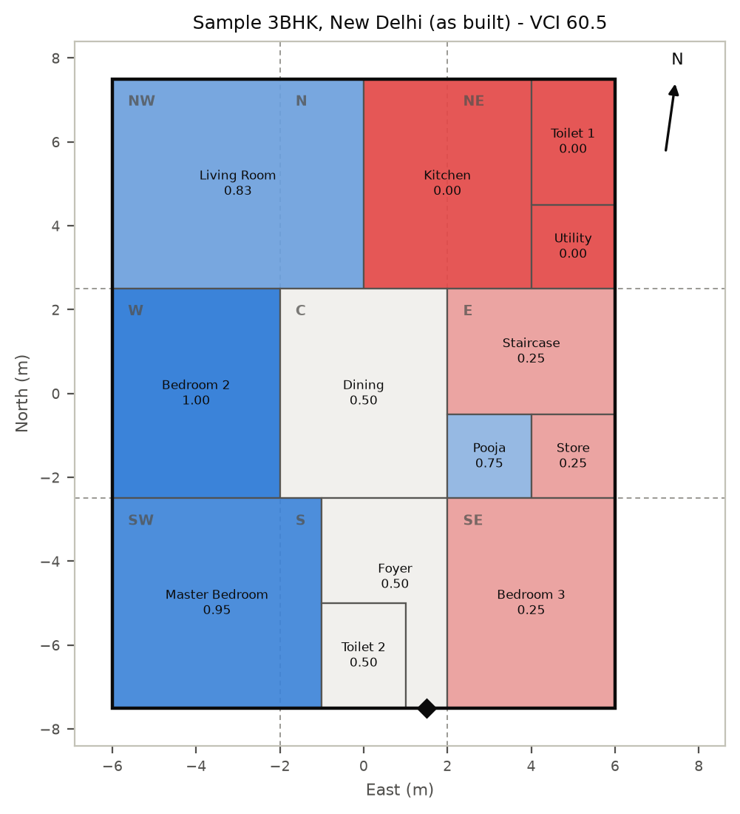
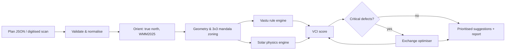

# vastu-floorplan-analyzer

[](https://github.com/madhukarverma/vastu-floorplan-analyzer/actions/workflows/ci.yml)


[](https://github.com/astral-sh/ruff)
[](LICENSE)

This tool analyses the architectural plan of a house against **Vastu Shastra** and
**first-principles solar physics**, then suggests improvements. Every step is deterministic.
**No AI or machine learning is used**: no neural image segmentation and no OCR. The geometry
is exact computational geometry, the rules are an auditable JSON knowledge base, and the
physics uses closed-form NOAA, Kasten–Young, Meinel and ASHRAE models.

<p align="center">
  
</p>

## What it does

| Stage | Method |
|---|---|
| Input | Plan as JSON polygons (footprint, rooms, doors, north arrow), or a scanned image traced by clicks with `vastu digitize` |
| Orientation | True north from the north arrow, with WMM2025 magnetic declination; exact rotation to a cardinal frame |
| Zoning | 3 × 3 Vastu-Purusha mandala; room membership by exact Sutherland–Hodgman clipping; 16-sector bearings |
| Vastu rules | Room–zone values, entrance sector, Brahmasthana, corner cuts, shape, SW-heavy mass dipole → **Vastu Compliance Index (VCI)** |
| Physics | NOAA sun position, Meinel clear-sky DNI, irradiation on every exterior wall, sol-air temperature, overhang sizing |
| Optimiser | Steepest-ascent exchange of room functions that maximises the VCI |
| Output | Prioritised findings with Vastu remedies and physical mitigations; text, Markdown or JSON report; annotated zone map |

## Quick start

```bash
git clone https://github.com/madhukarverma/vastu-floorplan-analyzer.git
cd vastu-floorplan-analyzer
python -m pip install -e ".[plot]"
vastu analyze examples/sample_3bhk_delhi.json --plot plan.png
```

```text
Vastu assessment: Sample 3BHK, New Delhi (as built)
  Vastu Compliance Index (VCI): 60.5 / 100  [Fair]
  components: rooms=45, entrance=50, brahmasthana=100, corners=100, shape=100, mass_balance=63
  after suggested exchanges: 75.8
  ...
  [CRITICAL]  Kitchen: 'Kitchen' lies mainly in the N zone (Uttara (Kubera)); placement compliance 0%.
              -> Preferred zone(s): SE. Place the cooking range in the SE corner of the kitchen ...
  [CRITICAL]  Toilet 1: 'Toilet 1' (toilet / bathroom) lies mainly in the NE zone (Ishanya (Ishana)) ...
  ...
  Suggested function exchanges (greedy optimiser):
  1. use 'Kitchen' as bedroom and 'Bedroom 3' as kitchen: VCI 60.5 -> 68.6 (+8.1)
  2. use 'Toilet 1' as pooja and 'Pooja' as toilet: VCI 68.6 -> 72.3 (+3.7)
  3. use 'Living Room' as bedroom and 'Kitchen' as living: VCI 72.3 -> 75.8 (+3.4)
```

Full sample reports are in [`examples/output/`](examples/output).

### Command-line interface

| Command | Purpose |
|---|---|
| `vastu analyze PLAN.json [-f text\|md\|json] [-o OUT] [--plot PNG] [--rules RULES.json] [--no-optimise]` | Assess a plan |
| `vastu solar --lat 28.61 --lon 77.21 --date 2026-06-21` | Facade irradiation / sol-air table for a site and day |
| `vastu rules` | Print the zone-value matrix of the rule base |
| `vastu digitize scan.png -o PLAN.json` | Click-trace a scanned plan into JSON (interactive, human in the loop) |

### Python API

```python
from vastu_analyzer import analyze, load_plan, to_markdown

result = analyze(load_plan("examples/sample_3bhk_delhi.json"))
print(result.vci, result.optimised_vci)
for f in result.findings[:3]:
    print(f.severity, f.subject, f.suggestion)
print(to_markdown(result))
```

## How it works



- **Why this approach?** Eight non-ML approaches were scored on a weighted decision matrix; see
  [docs/approaches.md](docs/approaches.md).
- **Step-by-step procedure:** [docs/procedure.md](docs/procedure.md).
- **Input format:** [docs/input-schema.md](docs/input-schema.md).
- **Research paper (PDF, physics-journal style):**
  [docs/paper/Vastu_Geometric_Physical_Framework.pdf](docs/paper/Vastu_Geometric_Physical_Framework.pdf).

## Key physical result

East and west walls in New Delhi receive the **same** daily irradiation on 21 June
(4.31 kWh m⁻²). The **west** wall's sol-air peak is still **6.5 K higher** (65.1 °C vs 58.6 °C),
because its beam load coincides with the afternoon air-temperature maximum. That is a
measurable basis for the Vastu maxim *heavy south-west, open north-east*. Claims about the
geomagnetic field, by contrast, are encoded only as cultural remedies, with no physical
rationale attached.

## Project layout

```
src/vastu_analyzer/
  geometry.py   shoelace area/centroid, Sutherland-Hodgman clipping, ray casting
  zoning.py     3x3 Vastu-Purusha mandala, 16-sector compass
  rules.py      knowledge-base loader (data/rules.json)
  solar.py      NOAA sun position, Kasten-Young, Meinel, sol-air temperature
  engine.py     scoring, findings, exchange optimiser
  report.py     text / Markdown / JSON
  plotting.py   annotated zone map (optional matplotlib)
  digitize.py   click-based digitiser for scans (optional matplotlib)
  cli.py        `vastu` command
tests/          72 unit tests (geometry, zoning, solar validation, engine, loader, CLI)
examples/       sample plans and generated reports
paper/          figure and PDF build scripts (ReportLab)
docs/           approaches ranking, procedure, schema, figures, paper PDF
```

## Development

```bash
python -m pip install -e ".[dev]"
pre-commit install
ruff check . && ruff format --check . && mypy && pytest --cov
```

Rebuild the paper and all its figures:

```bash
python -m pip install -e ".[paper]"
python paper/figures.py
python paper/build_paper.py
```

Edit `paper/metadata.json` to set the author block before rebuilding.

## Citing

See [CITATION.cff](CITATION.cff).

## Disclaimer

Vastu Shastra is a traditional system. This software measures compliance with a codified,
editable set of Vastu heuristics and reports physically grounded comfort indicators. It
does not claim that following Vastu has effects beyond those physical indicators. Consult a
qualified architect or structural engineer before making changes to a building.

## License

[MIT](LICENSE)
