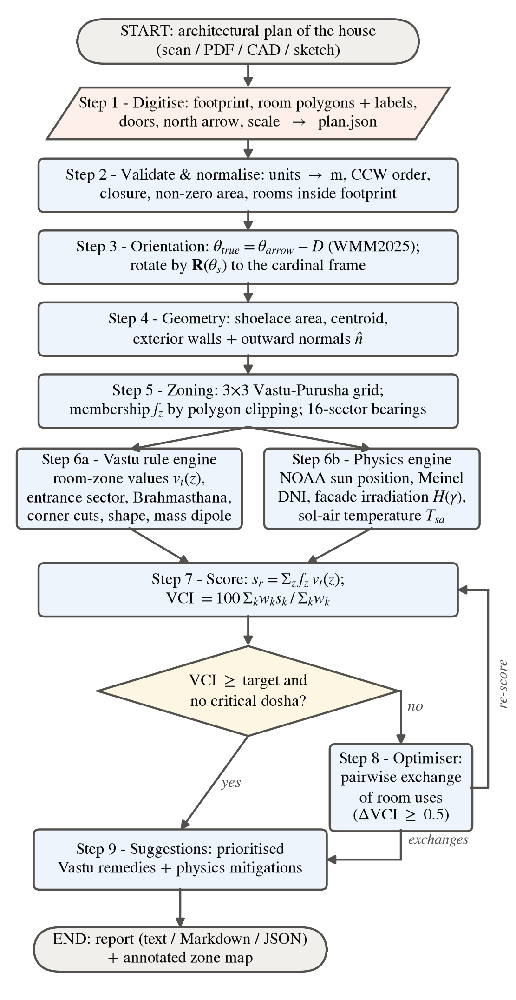
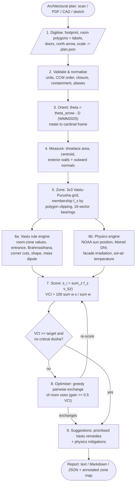

# Detailed procedure of the selected approach (A1)

## Step 1 — Digitise the plan

Record from the drawing:

| Item | How |
|---|---|
| Footprint | Outer wall outline as a closed polygon `[[x, y], ...]` |
| Rooms | One closed polygon per room plus a function label (`kitchen`, `toilet`, `master_bedroom`, ...) |
| Doors | Point on the wall for each entrance; mark the main one |
| North arrow | Angle clockwise from the sheet's "up" direction; whether it shows true or magnetic north |
| Scale | Units (`m`, `cm`, `mm`, `ft`, `in`) |
| Site (optional) | Latitude, longitude, time zone, used by the physics engine |

For a scanned plan, run `vastu digitize plan.png -o plan.json`. You click a known dimension
(scale), the north arrow, the footprint, then each room. The program only records the clicks.
It never interprets pixels, so no image AI is involved.

## Step 2 — Validate and normalise

All problems are collected in one pass and reported together:

- Schema version and supported units are checked, and every coordinate is converted to metres.
- Every polygon must have at least 3 vertices and non-zero area. All polygons are re-oriented
  counter-clockwise.
- Each room's centroid must lie inside the footprint.
- The north reference must be `true` or `magnetic`, and latitude/longitude must be in range.
- Aliases are resolved (`bathroom → toilet`, `puja → pooja`, `hall → living`, ...).
- If no door is marked as main, the first door becomes the main one.

## Step 3 — Orient

- True north: `θ = θ_arrow − D`, where `D` is the WMM2025 magnetic declination (east
  positive). In India `D` lies between −1.7° and +2.8°; Appendix B of the paper has a table.
- Bearing of any drawing vector: `β(v) = atan2(vx, vy) − θ (mod 360°)`.
- For zoning, the plan is rotated by the nearest cardinal angle `θs = 90°·round(θ/90°)`, so the
  mandala lines up with the walls as in classical practice. The residual skew `δ = θ − θs` is
  kept for the physics, which uses exact bearings. Plots with `|δ| > 15°` are flagged as
  *vidisha* (diagonal) plots.

## Step 4 — Measure

- Areas and centroids come from the shoelace formula.
- An edge is an **exterior wall** if its midpoint lies within 5 cm of the footprint boundary and
  a probe 10 cm along its outward normal falls outside the footprint. The wall's azimuth `γ`
  is the bearing of that outward normal.
- Footprint metrics: rectangularity `ρ = A / A_bbox`, aspect ratio, and the fill of each corner
  cell.

## Step 5 — Zone

- A 3 × 3 grid (Vastu-Purusha *Pitha* mandala) is laid over the footprint bounding box, giving
  the zones NW, N, NE / W, C, E / SW, S, SE. C is the Brahmasthana.
- Each room gets a membership vector `f_z = |R ∩ C_z| / |R|`, computed exactly by
  Sutherland–Hodgman clipping. The components sum to 1.
- Rooms and doors also get a 16-sector compass bearing measured from the footprint centroid.

## Step 6a — Apply Vastu rules ([rules.json](../src/vastu_analyzer/data/rules.json))

| Term | Definition |
|---|---|
| Room score | `s_i = Σ_z f_z(R_i) · v_t(z)`, where `v ∈ {0, .25, .5, .75, 1}`. Continuous in the geometry. |
| Entrance | Value of the door's 16-sector (N, NNE, NE, E ideal; SSW, SW avoid) |
| Brahmasthana | `1 − (area of centre cell occupied by toilet/kitchen/stairs/store/tanks) / cell area` |
| Corner cuts | Fill of the NE, SE, SW and NW cells (a NE cut is the gravest defect) |
| Shape | Rectangularity, penalised beyond a 1:2 aspect ratio |
| Mass dipole | Heaviness-weighted centroid offset `p`; ideal when it points SW (225°) |

## Step 6b — Apply physics ([solar.py](../src/vastu_analyzer/solar.py))

- **Sun position:** NOAA Fourier series for declination and equation of time; hour angle,
  altitude and azimuth.
- **Clear-sky beam:** Kasten–Young air mass and Meinel DNI `I = 1353 · 0.7^(AM^0.678)` W/m².
- **Wall irradiance:** beam `I·max(0, cos α cos(A − γ))`, plus ½ of the diffuse sky
  (10 % of beam), plus ½ of the ground reflection (albedo 0.2).
- **Sol-air temperature:** `T_sa = T_o + α_s I / h_o` (α_s = 0.6, h_o = 17 W/m²K), with a
  sinusoidal design day that peaks at 15:00.
- Each case is integrated over the summer solstice, the equinox and the winter solstice. Every
  room gets wall irradiation, the afternoon share and the peak `T_sa` of its hottest wall.

## Step 7 — Score

`VCI = 100 · Σ w·s / Σ w` over rooms, entrance, Brahmasthana, corners, shape and dipole.
Grades: ≥ 85 Excellent, 70–85 Good, 55–70 Fair, < 55 Poor.

## Step 8 — Optimise (if needed)

Steepest-ascent search over pairwise exchanges of room functions:

- Only movable rooms are exchanged; staircases, circulation, garages and open space stay fixed.
- An exchanged pair may differ in area by at most a factor of 2.
- Each step applies the best exchange gaining at least 0.5 VCI. The search stops at a local
  optimum. This is a deterministic combinatorial search, not learning.

## Step 9 — Suggest and report

Findings are sorted by severity (critical, major, minor, info) and by recoverable VCI
`100·w(1 − s)/Σw`. Each finding gives:

- the preferred zone(s),
- a practical traditional remedy,
- the traditional rationale and the physical rationale,
- for physics findings, quantitative mitigations: west-wall shading, the south overhang ratio
  `d/h = 1/tan α_noon(equinox)`, and ventilation for internal toilets.

The output is text, Markdown or JSON, plus an annotated zone map.
